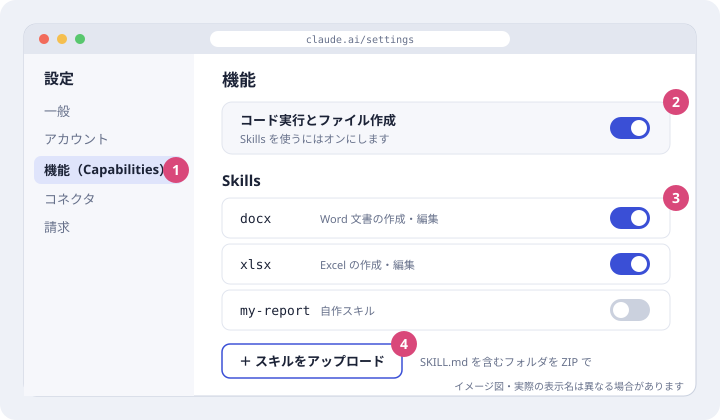
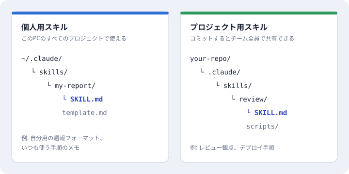
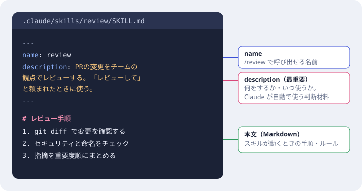
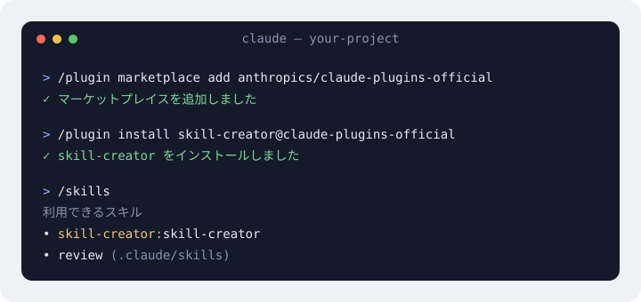

# Skills

Claude で使っている Skills をカテゴリ別の3Dパネルで一覧できるページと、スキルのセットアップ手順をまとめたリポジトリです。

## ページを開く

`index.html` をブラウザで開いてください。ビルドは不要です。

- 10カテゴリ（デザイン、データ、Figma、エンジニアリング、Web・フロントエンド、Cloudflare、ドキュメント・Office、リサーチ・自動操作、アーティファクト、Claude Code 本体）のパネルを回して見られます。
- スキルを選ぶと説明と呼び出し名が表示されます。
- ページ下部にセットアップ方法があります。

## スキルのセットアップ方法

### 1. Claude.ai・デスクトップアプリ

設定 → 機能（Capabilities）で「コード実行とファイル作成」をオンにし、Skills 欄で使うスキルをオンにします。自作スキルは `SKILL.md` を含むフォルダを ZIP にして「スキルをアップロード」から追加します。



### 2. Claude Code・自作スキル

自分用は `~/.claude/skills/スキル名/SKILL.md`、チーム共有はリポジトリの `.claude/skills/スキル名/SKILL.md` に置きます。



### 3. SKILL.md の書き方

先頭の `---` で囲んだ部分に `name` と `description` を書き、その下に手順を Markdown で書きます。`description` には「何をするか」と「いつ使うか」を具体的に書きます。



### 4. Claude Code・プラグインから追加

```text
/plugin marketplace add anthropics/claude-plugins-official
/plugin install skill-creator@claude-plugins-official
/skills
```



図はイメージです。実際のメニュー名は変わることがあります。

## 出典

- [Claude Code Docs: Skills](https://code.claude.com/docs/en/skills)
- [Claude ヘルプセンター: Skills の使い方](https://support.claude.com/en/articles/12512180)
